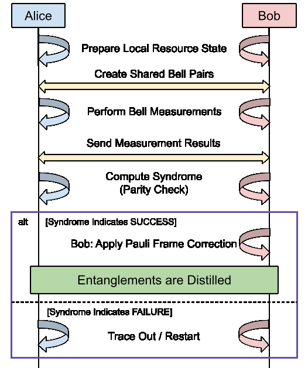
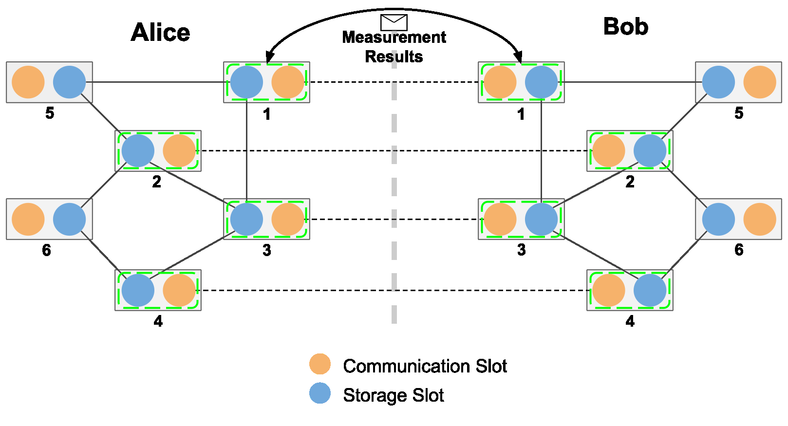

# MBQC-Based Entanglement Purification

This How-To runs the measurement-based quantum computing (MBQC) purification
example from the [QuantumSavory paper](https://arxiv.org/abs/2512.16752). The
protocol is from ["Measurement-Based Entanglement Distillation and Constant-Rate
Quantum Repeaters over Arbitrary
Distances"](https://journals.aps.org/prl/abstract/10.1103/2bp8-cdxc).

The full source is in
[`examples/purificationMBQC`](https://github.com/QuantumSavory/QuantumSavory.jl/tree/master/examples/purificationMBQC).

## Interactive Hardware Sources

To study hardware parameters with a live GLMakie plot, run from the repository root:

```sh
julia --project=examples -e 'using Pkg; Pkg.instantiate()'
julia --threads=2,1 --project=examples examples/purificationMBQC/interactive.jl
```

This example reuses the purification pipeline below. Local graph edges come from
`BarrettKokBellPairW`; long-range inputs come from
`StatesZoo.Genqo.GenqoMultiplexedCascadedBellPairW`. Each run uses a fresh snapshot
of the source sliders. The window starts automatically and keeps the latest 100
completed runs. Pause takes effect after the current run. Clear history also
discards any result that was in flight when it was clicked.

The horizontal axis shows simulated completion time in source attempt periods
(logarithmic scale). Accepted runs show the mean output Bell fidelity of their two
pairs; rejected runs appear on a separate labeled band, since they have no output
fidelity. Hover over a point for its source parameters. The visible-window summary
reports acceptance, mean accepted fidelity, and retained pairs per attempt period.
Clear history after adjusting sliders to study one configuration at a time.

The weighted state traces determine heralding probabilities. The simulation uses
normalized source states, corrects their Bell frames, and converts local Bell
pairs to graph edges before fusion. For real Barrett–Kok visibility, both models
are Bell diagonal. The example checks that their symbolic mixtures reproduce the
source density matrices, then uses exact Clifford Monte Carlo sampling. Each
generated pair is sampled independently. A trajectory's fidelity is 0, ½, or 1;
the mean over accepted trajectories estimates the conditional output fidelity.

Lower local mode overlap to investigate faulty resource preparation. Increase
Genqo mean photon number with losses present to compare faster generation with
lower input fidelity. Reduce local transmission at zero dark counts to change
waiting time without changing conditional local fidelity. Collect many runs at
each setting before comparing averages.

This experiment assumes ideal gates, measurements, and memories, with one common
source attempt period and no propagation delay. The Genqo weight is its
single-mode, fixed-click-pattern heralding probability; no additional multiplexing
or click-pattern factor is assumed. The photon-number slider is restricted to
`0.001 ≤ N ≤ 0.2`, within the documented useful range of the source model.
`QS_TESTRUN=true` bounds the interactive script to three runs.

### Sweep One Source Parameter

For aggregate figures of merit versus a source parameter, run the second dashboard:

```sh
julia --threads=2,1 --project=examples examples/purificationMBQC/sweep.jl
```

The left column shows the current setting's trials. The middle column has the
same nine sliders, plus a radio button beside each one. Select one parameter to
sweep; the other eight stay fixed. The sweep starts automatically with mean photon
number and visits 11 values over the selected slider's full range, including its
endpoints. The slider moves to each value as the simulation advances.

After 1,000 trials at a setting, the right column gains one point per aggregate
curve and the left column clears before the next setting. The plots show mean
accepted output fidelity (with input and local-pair reference fidelities),
acceptance probability, mean completion time, and retained pairs per attempt
period. The last two include the time spent in rejected trials. In particular,
the rate is two times the total accepted count divided by the total simulated
time. Output fidelity is missing when a batch accepts no trials; it is not zero.

The y-axes select log scales independently when all finite values on that axis
are positive and span at least 100×. Otherwise they stay linear, including when
a rate is zero. All four plots share an x-axis, labeled below the last plot.
The curves are Monte Carlo estimates; repeating the sweep can change them.

Pause preserves the current batch. Restart sweep clears all results and begins
again. Editing any slider or choosing a different sweep parameter also clears
the results and starts a sweep with the new fixed settings; an already paused
sweep remains paused. Results in flight from the old settings are discarded.
At the final value, the sweep stops and keeps the aggregate curves visible.
The same source and hardware assumptions as the continuous dashboard apply.
`QS_TESTRUN=true` runs two settings with five trials each and closes the window.

## Model

The protocol uses a `[[n,k,d]]` CSS code. Alice and Bob each prepare the local
resource state

```math
\frac{1}{\sqrt{2^k}}\bigotimes_{j=1}^{k}
\left(|\bar{0}_j\rangle|0_{n+j}\rangle
+ |\bar{1}_j\rangle|1_{n+j}\rangle\right).
```

Here, ``|\bar{0}_j\rangle`` and ``|\bar{1}_j\rangle`` are the encoded basis
states of logical qubit ``j``. The last ``k`` physical qubits hold the outputs.
The protocol consumes `n` noisy Bell pairs and keeps `k` pairs when the syndrome
check passes.

The example uses the `[[4,2,2]]` code. Each side has six nodes: the first four
hold the code qubits and the last two hold the outputs. Every node has two
slots: a communication qubit for entanglement generation and a storage qubit
for the resource state.

## Workflow At A Glance

Alice and Bob first prepare their local resource states. They then create four
shared noisy Bell pairs and measure each pair together with the matching
resource-state qubit. Both sides exchange their measurement results and use
them to compute the syndrome. A zero syndrome keeps the two output pairs, and
Bob applies the required Pauli-frame correction. A nonzero syndrome discards
the attempt so the protocol can start again.



The diagram below shows the physical layout for the `[[4,2,2]]` example. Orange
circles are communication slots, and blue circles are storage slots. Solid
lines show each local resource state. Dotted lines show the four noisy Bell
pairs shared by Alice and Bob. Each green box marks a Bell measurement between
a communication slot and its local storage slot. Nodes 5 and 6 hold the two
output pairs when purification succeeds.



## Protocol

1. **Prepare the resource states.** QuantumClifford maps the stabilizer resource
   state to a graph state and local Clifford corrections. `graph_builder`
   groups graph edges that do not share a node. `GraphStateConstructor` creates
   each group in parallel and uses `Fusion` to move it into storage. Alice and
   Bob run this process independently. `GraphToResource` then applies the local
   corrections.
2. **Generate the noisy pairs.** [`EntanglerProt`](@ref) creates four noisy Bell
   pairs between matching Alice and Bob communication qubits.
3. **Measure the pairs.** `PurifierBellMeasurements` Bell-measures each noisy
   pair half with its resource-state qubit. It packs the `XX` and `ZZ` outcomes
   into two integers, stores the local result as a tag, and sends the same
   result to the other side.
4. **Check the syndrome.** `MBQCPurificationTracker` waits for the local tag and
   the remote message. It combines the outcomes and computes the CSS syndrome.
   A zero syndrome is accepted. Bob applies the Pauli X/Z corrections, and both
   sides mark the two outputs with
   [`PurifiedEntanglementCounterpart`](@ref). On failure, both sides discard the
   qubits used by that attempt.

These steps are separate resumable processes. They coordinate through tags and
messages instead of direct references to each other. This lets the example
combine multipartite graph-state preparation with asynchronous classical
control.

## Run The Example

From the repository root, run:

```sh
julia --project=examples examples/purificationMBQC/full_purification_example.jl
```

The script first uses perfect input pairs and checks that both output pairs have
fidelity one. It then sweeps over Werner-state input fidelities. For each value,
it records the acceptance rate and the mean output fidelity conditioned on
acceptance.

Run the plot script with:

```sh
julia --project=examples examples/purificationMBQC/plots.jl
```

It compares the simulated acceptance rate with
``P_\mathrm{accept}=(1+3p^4)/4``, where ``p=(4F-1)/3``, and plots the output
fidelity.

## Current Assumptions

The example uses noiseless storage, a pair-generation success probability of
one, and Werner-state noise on the shared input pairs. Its ordering of local
resource preparation and long-range pair generation is only one possible
choice.

The current tracker expects consecutive node numbers on each side, with the
chief node first and matching layouts. Measurement outcomes are packed into an
`Int64`, so `n` must be at most 63. The shipped `[[4,2,2]]` resource conversion
needs only Hadamard corrections. `GraphToResource` currently errors if the
graph conversion requests inverse-phase or Z corrections.
