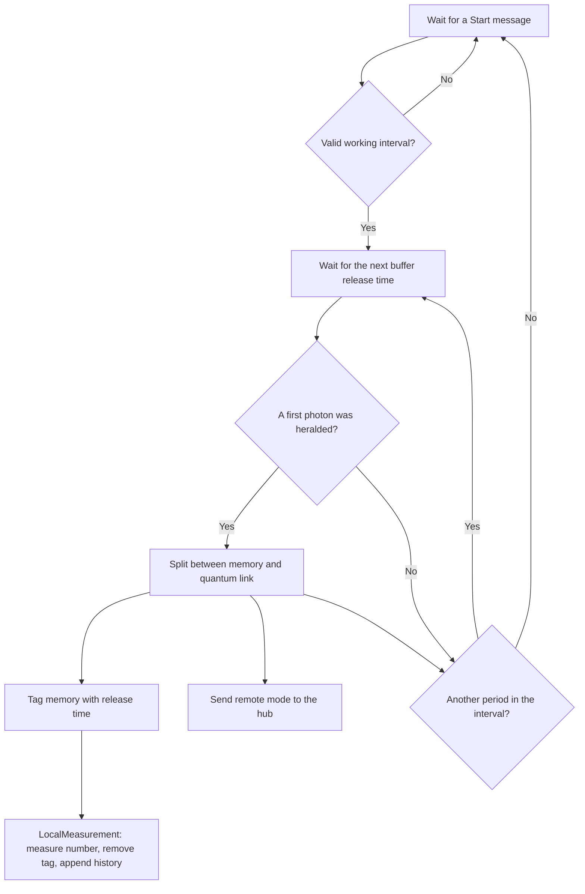
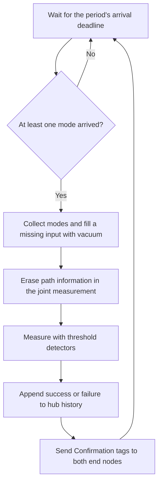

# ASPEN-Net: two sources and one hub

Run `julia --project=examples examples/aspen_net/1_simple_run.jl` from the
repository root. This example uses the internal `ProtocolZoo.AspenNet` module;
its interface is experimental.

Two end nodes share a global clock and send photons to one hub. Each receives
one `Start(start_tick, stop_tick)` message with an integer-tick working interval.
A source keeps the first heralded
photon in each buffer period, then releases it at the agreed time. Its unbalanced
beam splitter distributes the photon between local memory and the quantum link.
Here, `reflectivity=0.1` sends 10% of the photon probability to the hub. Quantum
and classical links have equal delays.

Local number measurements immediately consume the memories. The hub erases path
information and records a threshold-detector result only when at least one mode
arrives. Periods with no arrivals produce no measurement, log entry, or
confirmation. An arriving mode can be vacuum after local measurement and still
produces a success/failure result. A missing second input is vacuum.
A single incoming photon can produce a success, and
two incoming photons can produce a false herald because the detectors do not
resolve photon number. Compare the internal `_log` histories by `period`;
local `t` is the release time and hub `t` includes the one-way delay. This example
does not retain an entangled memory pair after local measurement.

The text displays summarize each history. With `CairoMakie` loaded,
`display(MIME"image/png"(), hub)` renders the hub history as a plot.





## Digital twin

Run the live example from the repository root:

```bash
julia --threads=2,1 --project=examples examples/aspen_net/2_digital_twin.jl
```

Open the dashboard at `http://127.0.0.1:8897`. The register network appears above
five protocol panels: two sources, two local measurements, and the hub. Memories
are usually empty because local measurements consume them immediately.
The live Hardware snapshot shows modeled shared-clock time, tick duration, and
repetitions. The Simulation snapshot shows wall-clock pacing.

An analysis row counts the measured photon-number pairs at nodes 1 and 3 in
separate 2×2 heatmaps for hub successes and failures. Records are matched by
buffer `period`; each count requires measurement records from both end nodes and
the hub.
The six bars count periods with all three records, only node 1 and hub, only
node 3 and hub, node 1 without hub, node 3 without hub, and both nodes without hub,
in that order. The last three overlap: a period present at both sources but still
awaiting the hub appears in all three bars.
All three analysis titles report "out of X total generation attempts". An attempt
is a completed buffer period with at least one source scheduled, including
periods producing no photon. Shared periods count once; idle and future periods
are excluded.

The simulation advances in a background task independently of browser sessions.
The API and dashboard share that simulation. Sources remain idle until an API
request schedules them; closing a browser tab does not stop the simulation.
By default, a fresh simulation replaces it at 100000 simulation-time units:
histories, counts, and pending commands are cleared, and sources return to idle.
The servers and open browser sessions stay connected.
Each simulation step (one unit by default) is followed by a configurable wall-clock
sleep (default 0.1 seconds). Zero removes the deliberate delay. This is approximate
pacing, and the setting persists across resets.
The launch command reserves two default threads and one interactive thread for
HTTP and UI work. Stop Julia with Ctrl-C to stop the simulation and both servers.

The Oxygen API runs at `http://127.0.0.1:8081`; its interactive documentation is
at `/docs`, with the OpenAPI schema at `/docs/schema`.

| Request | Result |
| --- | --- |
| `GET /api/status` | Modeled hardware `time`, `tick_duration`, and `repetitions` |
| `GET /api/simulation/status` | Current wall-clock pacing, `sleep_seconds` |
| `GET /api/simulation/config` | JSON configuration used for initial setup and resets |
| `POST /api/simulation/pacing?sleep_seconds=...` | Set pacing and return the current `sleep_seconds` |
| `POST /api/nodes/{node}/start?start_tick=...&stop_tick=...` | Schedule a configured source node (`1` or `3` by default) |
| `GET /api/nodes/{node}/log` | Copy of a configured source node's local measurement history |
| `GET /api/hub/log` | Copy of the hub's success/failure history |

The configuration contains `network`, `protocol`, and `simulation` sections.
It is the twin's own copy of its startup settings, including overrides, and is
reused on reset. `simulation.initial_sleep_seconds` sets initial pacing; current
pacing is reported by `/api/simulation/status` and persists across resets.
For custom startup in Julia, edit the symbol-keyed dictionary returned by
`AspenNetTwin.default_config()` and pass it to `AspenNetTwin.prepare_twin(config)`.

The `time` field represents the modeled shared hardware clock used to schedule
working intervals; a hardware deployment needs the same clock reading.
Start and stop ticks must be future multiples of `repetitions`. Invalid or past
intervals return HTTP 400; overlapping accepted intervals return HTTP 409.
Negative or nonfinite pacing values return HTTP 400.
Keep working intervals below the configured reset time (100000 by default).
Commands extending beyond that horizon are accepted, but the reset discards their
remaining work.
Choose the same future interval for both nodes so their releases coincide. This
client uses a lead of at least five buffer periods and a 100-period run:

```bash
curl -fsS -X POST 'http://127.0.0.1:8081/api/simulation/pacing?sleep_seconds=0.02'
status=$(curl -fsS http://127.0.0.1:8081/api/status)
start_tick=$(printf '%s' "$status" | jq '((.time / (.tick_duration * .repetitions) | ceil) + 5) * .repetitions')
repetitions=$(printf '%s' "$status" | jq .repetitions)
stop_tick=$((start_tick + 100 * repetitions))
for node in 1 3; do
    curl -fsS -X POST "http://127.0.0.1:8081/api/nodes/$node/start?start_tick=$start_tick&stop_tick=$stop_tick"
done
# Query again after the scheduled start to see local measurements.
curl -fsS http://127.0.0.1:8081/api/nodes/1/log
curl -fsS http://127.0.0.1:8081/api/hub/log
```

UI settings use `QS_ASPEN_NET_IP`, `QS_ASPEN_NET_PORT`, and `QS_ASPEN_NET_PROXY`.
API settings use `QS_ASPEN_NET_API_IP`, `QS_ASPEN_NET_API_PORT`,
`QS_ASPEN_NET_API_PROXY`, `QS_ASPEN_NET_API_PREFIX`, and
`QS_ASPEN_NET_API_DOCPATH`. Defaults are the loopback addresses and ports above,
no proxy or prefix, and `/docs`. The API proxy setting is an external origin;
its optional prefix applies to API routes, documentation, and schema.
