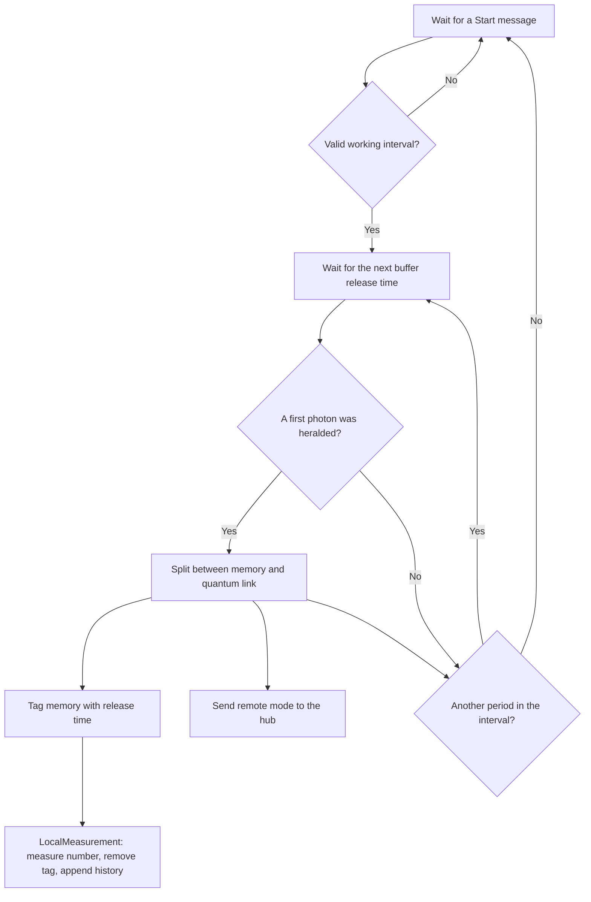
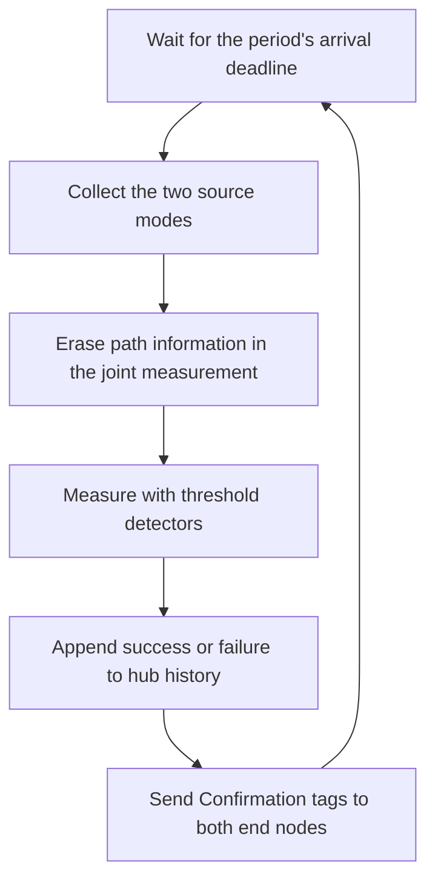

# ASPEN-Net: two sources and one hub

Run `julia --project=examples examples/aspen_net/1_simple_run.jl` from the
repository root. This example uses the internal `ProtocolZoo.AspenNet` module;
its interface is experimental.

Two end nodes share a global clock and send photons to one hub. Each receives
one `Start(start_tick, stop_tick)` message with an integer-tick working interval.
A source keeps the first heralded
photon in each buffer period, then releases it at the agreed time. Its unbalanced
beam splitter distributes the photon between local memory and the quantum link.
Here, `reflectivity=0.1` sends 10% of the photon probability to the hub. Quantum
and classical links have equal delays.

Local number measurements immediately consume the memories. The hub erases path
information and records a threshold-detector success or failure for each period.
Missing inputs are vacuum; a single incoming photon can produce a success, and
two incoming photons can produce a false herald because the detectors do not
resolve photon number. Compare the internal `_log` histories by `period`;
local `t` is the release time and hub `t` includes the one-way delay. This example
does not retain an entangled memory pair after local measurement.

The text displays summarize each history. With `CairoMakie` loaded,
`display(MIME"image/png"(), hub)` renders the hub history as a plot.

